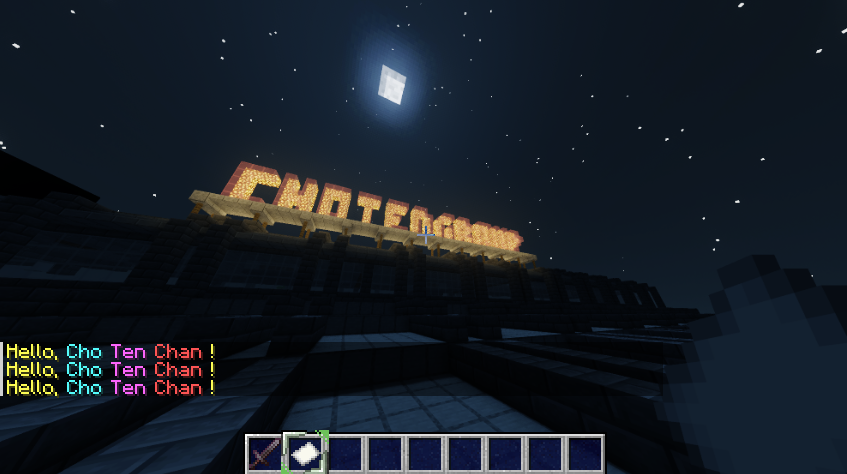

# Item Actions

**Sertraline** supports you run action when interact the item.

### Action Structure in YAML <a href="#action-structure-in-yaml" id="action-structure-in-yaml"></a>

Actions are defined within the `sertraline` section of an item YAML file under the `actions` key. The structure follows this pattern:

```yaml
item_id:
  sertraline:
    actions:
      <trigger_name>:
        - condition: <kether_expression_list>
          async: <boolean>
          kether: <kether_script_list>
          javascript: <javascript_string>
          jexl: <jexl_string>
          fluxon: <fluxon_string>
          graaljs: <graaljs_string>
```

Each trigger name maps to a list of action entries. Multiple actions can be defined for the same trigger, and they execute sequentially.

Example:


```yaml
book_of_multi_language:
  xbuilder:
    name: "<!i>&6Book of Multi Language"
    lore: |
      <!i><white>A book of multi-script language.
    material: book
  sertraline:
    vals:
      testvariable: 114514
    actions:
      onLeftClick:
        - condition: check 1 == 1
        - gjs: |
            player.sendMessage(mmUtil.deserialize("<gradient:yellow:#aaaa66>A welcome from GraalJS!"));
          kether: |
            minitell inline "<gradient:white:gray>Hello, kether with val {{ &val }} !"
          js: |
            var days = 1;
            var base = 100;
            var daily = days * 10;
            var weekBonus = (days / 7) * 100;
            var tag = ItemStackUtil.getItemTag(bItem);
            tag.put("Javascript_Modifyed_NBT", "Hello, Javascript!");
            ItemStackUtil.setItemTagDirect(bItem, tag);
            player.sendMessage(mmUtil.deserialize("<gradient:red:gold>Hello, JavaScript with math " + weekBonus.toString() + " !"))
          jexl: |
            player.sendMessage(mmUtil.deserialize("<gradient:dark_aqua:blue>Hello, Jexl with math " + Math.max(1, 2) + " !"))
          fluxon: |
            import 'sertraline:bukkit'
            import 'sertraline:component'
            v = "Fluxon!";
            &player::sendMessage("Hello, " + &v + "With insert a item variable " + &testvariable)
```


### Triggers


The following table lists all supported trigger types and their associated Bukkit events:

| Trigger Name       | Bukkit Event                | Description                           | Cancellable | Available Items                            |
| ------------------ | --------------------------- | ------------------------------------- | ----------- | ------------------------------------------ |
| `onClick`          | `PlayerInteractEvent`       | Any click interaction (left or right) | Yes         | `bItem` (clicked item)                     |
| `onRightClick`     | `PlayerInteractEvent`       | Right-click interaction only          | Yes         | `bItem` (clicked item)                     |
| `onLeftClick`      | `PlayerInteractEvent`       | Left-click interaction only           | Yes         | `bItem` (clicked item)                     |
| `onAttack`         | `EntityDamageByEntityEvent` | Player attacks entity with item       | Yes         | `bItem` (weapon/projectile)                |
| `onMine`           | `BlockBreakEvent`           | Player breaks block                   | Yes         | Composite only (see below)                 |
| `onConsume`        | `PlayerItemConsumeEvent`    | Player consumes food/potion           | Yes         | `bItem` (consumed), `abItem` (replacement) |
| `onBreak`          | `PlayerItemBreakEvent`      | Item breaks from durability           | No          | `bItem` (broken item)                      |
| `onDrop`           | `PlayerDropItemEvent`       | Player drops item                     | Yes         | `bItem` (dropped item)                     |
| `onPickUp`         | `PlayerPickupItemEvent`     | Player picks up item                  | Yes         | `bItem` (picked up item)                   |
| `onInventoryClick` | `InventoryClickEvent`       | Player clicks in inventory            | Yes         | `bItem` (current), `abItem` (cursor)       |
| `onSwap`           | `PlayerSwapHandItemsEvent`  | Player swaps main/offhand (F key)     | Yes         | Composite only (see below)                 |
| `onLogin`          | `PlayerLoginEvent`          | Player logs into server               | No          | Composite only (see below)                 |

### Composite Triggers <a href="#composite-triggers" id="composite-triggers"></a>

Some triggers support composite syntax using the `@` separator to target specific equipment slots or hands. The format is `trigger@slot`.

#### Syntax <a href="#syntax" id="syntax"></a>

`triggerName@slotName`

#### Supported Composite Triggers <a href="#supported-composite-triggers" id="supported-composite-triggers"></a>

**onLogin**

Fires when a player logs in, checking all equipped items:

* `onLogin@main` - Main hand item
* `onLogin@off` - Offhand item
* `onLogin@helmet` - Helmet slot
* `onLogin@chestplate` - Chestplate slot
* `onLogin@leggings` - Leggings slot
* `onLogin@boots` - Boots slot

**onMine**

Fires when a player breaks a block:

* `onMine@main` - Main hand item
* `onMine@off` - Offhand item

**onSwap**

Fires when a player swaps hands (presses F):

* `onSwap@main` - Item being moved to offhand
* `onSwap@off` - Item being moved to main hand

### Advanced

The val, var and dynamic will be a variable into script.

You can directly use it like:

<pre class="language-yml"><code class="lang-yml">message_helper:
  sertraline:
    tier: S
    vals:
<strong>      message: "&#x3C;yellow>Hello, &#x3C;aqua>Cho &#x3C;#ff66ff>Ten &#x3C;red>Chan &#x3C;yellow>!"
</strong>    actions:
      onRightClick:
        - async: true
          js: |
<strong>            player.sendMessage(mmUtil.deserialize(message)); 
</strong>  xbuilder:
    name: "&#x3C;!i>&#x3C;#cc99cc>Message Helper"
    lore: |
      &#x3C;!i>&#x3C;#aaaadd>Say hello for you!
    material: PAPER
</code></pre>

<figure><figcaption></figcaption></figure>

You may also **use or modify** event's parameters like:

<pre class="language-yaml"><code class="lang-yaml">sword_of_ultimate_damage:
  sertraline:
    tier: S
    actions:
      onAttack:
<strong>        - async: false # If cancel event or modify event content, async must be false (default to true).
</strong>          js: |
<strong>            event.damage = 100
</strong>  xbuilder:
    name: "&#x3C;!i>&#x26;eGolden Sword Of &#x26;cOne hundred Damage"
    lore: |
      &#x3C;!i>&#x3C;gold>+100 Damage.
    material: GOLDEN_SWORD
</code></pre>

To cancel a event, just use:

```javascript
event.setCancelled(true)
// OR event.isCancelled = true
```


If **cancel event or modify** event content, `async` must be `false`.


### Give Item Example

```yaml
a_pack_of_gum:
  xbuilder:
    name: "<!i><#ffcc66><bold>a pack of gum"
    material: PAPER
  sertraline:
    tier: S
    lore-format: default
    actions:
      onRightClick:
        - async: false
          gjs: |
            bItem.amount--
            player.give(SertralineAPI.buildItem("gum", player, null, 10, new Map()))
```
