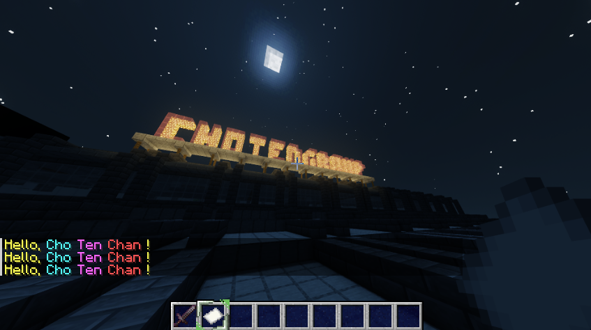

# Item Actions

Under `actions`, give each trigger a list. Save this example in `workspace/guide_signal.yml`, reload, and run `/sertralineitem give guide_signal`. Right-click with the compass in your main hand or off hand. In the main hand, the condition lets the first message run, and sneaking enables a second message.

```yaml
guide_signal:
  xbuilder:
    material: COMPASS
  sertraline:
    actions:
      onRightClick:
        - async: false
          condition:
            - "check 1 == 1"
          kether: 'tell "Signal received."'
        - async: false
          graaljs: |
            if (player.isSneaking()) {
              player.sendMessage("Sneaking signal.");
            }
      "onRightClick@off":
        - async: false
          kether:
            - 'tell "Off-hand signal."'
```

## Built-in triggers

| Trigger | When it runs and which item it reads |
| --- | --- |
| `onClick`, `onRightClick`, `onLeftClick` | Interact with a block or the air. Use `@off` for off hand. Main hand uses the bare trigger name |
| `onAttack` | Uses the main-hand weapon for melee or a recorded weapon for projectile impact |
| `onShoot` | Uses the weapon when firing a bow or similar weapon |
| `onShootTrident` | Uses the trident when Riptide triggers, on builds with that event |
| `onMine` | Checks both hands on block break. Supports `@main` and `@off` |
| `onConsume` | Uses the item being eaten, drunk or otherwise consumed |
| `onBreak` | Uses the item that breaks when its durability runs out |
| `onDrop` | Uses the dropped item |
| `onPickUp` | Uses the item being picked up, on builds with the pickup event |
| `onInventoryClick` | Uses the item in the clicked inventory slot |
| `onSwap` | Uses the two swapped hand items. `@main` and `@off` describe their destinations |
| `onSneak` | Checks both hands when entering or leaving sneak. Supports `@main` and `@off` |
| `onLogin` | Checks equipment on login. Supports `@main`, `@off`, `@helmet`, `@chestplate`, `@leggings` and `@boots` |

A base trigger and its suffixed variant can both run for the same event. A base trigger that checks multiple slots can run for multiple items. For other Bukkit events, see [Custom Events and Global Listeners](../../event-listeners.md).

## Conditions, scripts and execution

| Action entry field | How to use it |
| --- | --- |
| `condition`, `require`, `requirement`, `requirements` | One Kether condition or a list. All conditions must pass. Omit it to run unconditionally |
| `async` | Defaults to `true`. Use `false` to access the inventory or world, change damage, or cancel an event |
| `kether` / `ke` | A Kether string or list of script lines |
| `javascript` / `js` | JavaScript text. Use `\|` for multiple lines |
| `jexl` / `je` | JEXL text |
| `fluxon` / `fl` | Fluxon text |
| `graaljs` / `gjs` | GraalJS text |
| `mythic` / `mm` | With MythicMobs, use a mechanic string or list. Append `~trigger` to choose a MythicMobs trigger |

You can set several script fields in one entry. Once the condition passes they run in the order Kether, JavaScript, JEXL, Fluxon, GraalJS, and MythicMobs. To try several forms, replace the existing `onRightClick` under `sertraline.actions` with this snippet.

```yaml
onRightClick:
  - async: false
    kether: 'tell "Kether"'
    js: 'player.sendMessage("JavaScript");'
    jexl: 'player.sendMessage("JEXL");'
    fluxon: |
      import 'sertraline:bukkit'
      &player::sendMessage("Fluxon")
    graaljs: 'player.sendMessage("GraalJS");'
```

Scripts can read `player`, `event`, `bItem` (the actual stack), `sItem` (the definition), and keys from item data. For a cancellable event, use `cancellableEvent`. For example, set `async: false` and `js: 'cancellableEvent.setCancelled(true);'` in `onDrop` to prevent dropping.

Set the default interval in milliseconds with `action.throttle-time` in `config.yml`. Override per base trigger under `action.throttle`, such as `onRightClick: 1000`. Set it to `0` to turn off throttling for that trigger. Find more examples in `workspace/default/default_weapon.yml` and `default_consumable.yml`, or see [Item Data](item-data.md) to save a variable from an action.


## Source check

Checked against plugin revision `032ee71` (November 26, 2026): action entries run asynchronously by default; set `async: false` when a script needs synchronous event, inventory, or world access. All configured conditions must pass before the scripts run. The examples above use the current action fields and hand suffixes.

<details>
<summary>Archived original English text (preserved verbatim)</summary>

---
icon: wave-pulse
---

# Item Actions

**Sertraline** supports you run action when interact the item.

### Action Structure in YAML <a href="#action-structure-in-yaml" id="action-structure-in-yaml"></a>

Actions are defined within the `sertraline` section of an item YAML file under the `actions` key. The structure follows this pattern:

```yaml
item_id:
  sertraline:
    actions:
      <trigger_name>:
        - condition: <kether_expression_list>
          async: <boolean>
          kether: <kether_script_list>
          javascript: <javascript_string>
          jexl: <jexl_string>
          fluxon: <fluxon_string>
          graaljs: <graaljs_string>
```

Each trigger name maps to a list of action entries. Multiple actions can be defined for the same trigger, and they execute sequentially.

Example:


```yaml
book_of_multi_language:
  xbuilder:
    name: "<!i>&6Book of Multi Language"
    lore: |
      <!i><white>A book of multi-script language.
    material: book
  sertraline:
    vals:
      testvariable: 114514
    actions:
      onLeftClick:
        - condition: check 1 == 1
        - gjs: |
            player.sendMessage(mmUtil.deserialize("<gradient:yellow:#aaaa66>A welcome from GraalJS!"));
          kether: |
            minitell inline "<gradient:white:gray>Hello, kether with val {{ &val }} !"
          js: |
            var days = 1;
            var base = 100;
            var daily = days * 10;
            var weekBonus = (days / 7) * 100;
            var tag = ItemStackUtil.getItemTag(bItem);
            tag.put("Javascript_Modifyed_NBT", "Hello, Javascript!");
            ItemStackUtil.setItemTagDirect(bItem, tag);
            player.sendMessage(mmUtil.deserialize("<gradient:red:gold>Hello, JavaScript with math " + weekBonus.toString() + " !"))
          jexl: |
            player.sendMessage(mmUtil.deserialize("<gradient:dark_aqua:blue>Hello, Jexl with math " + Math.max(1, 2) + " !"))
          fluxon: |
            import 'sertraline:bukkit'
            import 'sertraline:component'
            v = "Fluxon!";
            &player::sendMessage("Hello, " + &v + "With insert a item variable " + &testvariable)
```


### Triggers


The following table lists all supported trigger types and their associated Bukkit events:

| Trigger Name       | Bukkit Event                | Description                           | Cancellable | Available Items                            |
| ------------------ | --------------------------- | ------------------------------------- | ----------- | ------------------------------------------ |
| `onClick`          | `PlayerInteractEvent`       | Any click interaction (left or right) | Yes         | `bItem` (clicked item)                     |
| `onRightClick`     | `PlayerInteractEvent`       | Right-click interaction only          | Yes         | `bItem` (clicked item)                     |
| `onLeftClick`      | `PlayerInteractEvent`       | Left-click interaction only           | Yes         | `bItem` (clicked item)                     |
| `onAttack`         | `EntityDamageByEntityEvent` | Player attacks entity with item       | Yes         | `bItem` (weapon/projectile)                |
| `onMine`           | `BlockBreakEvent`           | Player breaks block                   | Yes         | Composite only (see below)                 |
| `onConsume`        | `PlayerItemConsumeEvent`    | Player consumes food/potion           | Yes         | `bItem` (consumed), `abItem` (replacement) |
| `onBreak`          | `PlayerItemBreakEvent`      | Item breaks from durability           | No          | `bItem` (broken item)                      |
| `onDrop`           | `PlayerDropItemEvent`       | Player drops item                     | Yes         | `bItem` (dropped item)                     |
| `onPickUp`         | `PlayerPickupItemEvent`     | Player picks up item                  | Yes         | `bItem` (picked up item)                   |
| `onInventoryClick` | `InventoryClickEvent`       | Player clicks in inventory            | Yes         | `bItem` (current), `abItem` (cursor)       |
| `onSwap`           | `PlayerSwapHandItemsEvent`  | Player swaps main/offhand (F key)     | Yes         | Composite only (see below)                 |
| `onLogin`          | `PlayerLoginEvent`          | Player logs into server               | No          | Composite only (see below)                 |

### Composite Triggers <a href="#composite-triggers" id="composite-triggers"></a>

Some triggers support composite syntax using the `@` separator to target specific equipment slots or hands. The format is `trigger@slot`.

#### Syntax <a href="#syntax" id="syntax"></a>

`triggerName@slotName`

#### Supported Composite Triggers <a href="#supported-composite-triggers" id="supported-composite-triggers"></a>

**onLogin**

Fires when a player logs in, checking all equipped items:

* `onLogin@main` - Main hand item
* `onLogin@off` - Offhand item
* `onLogin@helmet` - Helmet slot
* `onLogin@chestplate` - Chestplate slot
* `onLogin@leggings` - Leggings slot
* `onLogin@boots` - Boots slot

**onMine**

Fires when a player breaks a block:

* `onMine@main` - Main hand item
* `onMine@off` - Offhand item

**onSwap**

Fires when a player swaps hands (presses F):

* `onSwap@main` - Item being moved to offhand
* `onSwap@off` - Item being moved to main hand

### Advanced

The val, var and dynamic will be a variable into script.

You can directly use it like:

<pre class="language-yml"><code class="lang-yml">message_helper:
  sertraline:
    tier: S
    vals:
<strong>      message: "&#x3C;yellow>Hello, &#x3C;aqua>Cho &#x3C;#ff66ff>Ten &#x3C;red>Chan &#x3C;yellow>!"
</strong>    actions:
      onRightClick:
        - async: true
          js: |
<strong>            player.sendMessage(mmUtil.deserialize(message)); 
</strong>  xbuilder:
    name: "&#x3C;!i>&#x3C;#cc99cc>Message Helper"
    lore: |
      &#x3C;!i>&#x3C;#aaaadd>Say hello for you!
    material: PAPER
</code></pre>

<figure><figcaption></figcaption></figure>

You may also **use or modify** event's parameters like:

<pre class="language-yaml"><code class="lang-yaml">sword_of_ultimate_damage:
  sertraline:
    tier: S
    actions:
      onAttack:
<strong>        - async: false # If cancel event or modify event content, async must be false (default to true).
</strong>          js: |
<strong>            event.damage = 100
</strong>  xbuilder:
    name: "&#x3C;!i>&#x26;eGolden Sword Of &#x26;cOne hundred Damage"
    lore: |
      &#x3C;!i>&#x3C;gold>+100 Damage.
    material: GOLDEN_SWORD
</code></pre>

To cancel a event, just use:

```javascript
event.setCancelled(true)
// OR event.isCancelled = true
```


If **cancel event or modify** event content, `async` must be `false`.


### Give Item Example

```yaml
a_pack_of_gum:
  xbuilder:
    name: "<!i><#ffcc66><bold>a pack of gum"
    material: PAPER
  sertraline:
    tier: S
    lore-format: default
    actions:
      onRightClick:
        - async: false
          gjs: |
            bItem.amount--
            player.give(SertralineAPI.buildItem("gum", player, null, 10, new Map()))
```

</details>
