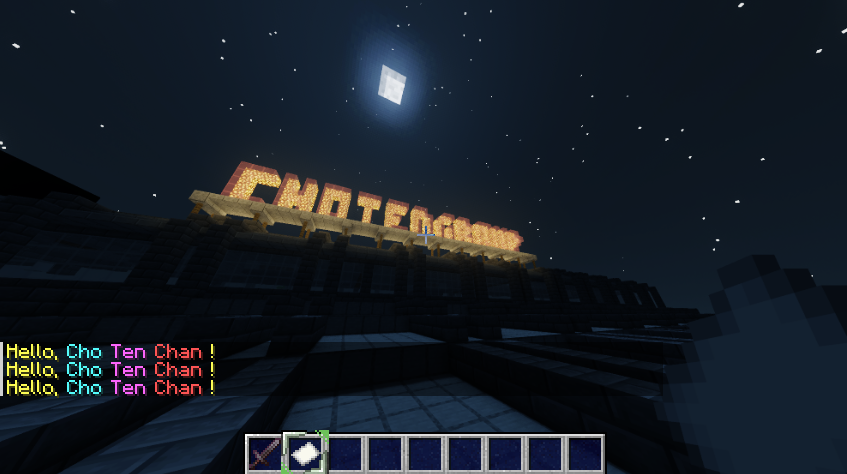

# 物品动作

**Sertraline** 支持您在与物品互动时执行动作。

### YAML 中的操作结构 <a href="#action-structure-in-yaml" id="action-structure-in-yaml"></a>

动作定义在物品 YAML 的 `sertraline.actions` 下，结构如下：

```yaml
item_id:
  sertraline:
    actions:
      <trigger_name>:
        - condition: <kether_expression_list>
          async: <boolean>
          kether: <kether_script_list>
          javascript: <javascript_string>
          jexl: <jexl_string>
          fluxon: <fluxon_string>
          graaljs: <graaljs_string>
```

每个触发器名称都映射到一个操作条目列表。可以为同一个触发器定义多个操作，这些操作将按顺序执行。

示例：


```yaml
book_of_multi_language:
  xbuilder:
    name: "<!i>&6Book of Multi Language"
    lore: |
      <!i><white>A book of multi-script language.
    material: book
  sertraline:
    vals:
      testvariable: 114514
    actions:
      onLeftClick:
        - condition: check 1 == 1
        - gjs: |
            player.sendMessage(mmUtil.deserialize("<gradient:yellow:#aaaa66>A welcome from GraalJS!"));
          kether: |
            minitell inline "<gradient:white:gray>Hello, kether with val {{ &val }} !"
          js: |
            var days = 1;
            var base = 100;
            var daily = days * 10;
            var weekBonus = (days / 7) * 100;
            var tag = ItemStackUtil.getItemTag(bItem);
            tag.put("Javascript_Modifyed_NBT", "Hello, Javascript!");
            ItemStackUtil.setItemTagDirect(bItem, tag);
            player.sendMessage(mmUtil.deserialize("<gradient:red:gold>Hello, JavaScript with math " + weekBonus.toString() + " !"))
          jexl: |
            player.sendMessage(mmUtil.deserialize("<gradient:dark_aqua:blue>Hello, Jexl with math " + Math.max(1, 2) + " !"))
          fluxon: |
            import 'sertraline:bukkit'
            import 'sertraline:component'
            v = "Fluxon!";
            &player::sendMessage("Hello, " + &v + "With insert a item variable " + &testvariable)
```


### 触发器


下表列出了所有受支持的触发器类型及其关联的Bukkit事件：

| 触发名称       | Bukkit 事件                | 说明                           | 可取消 | 可用物品                            |
| ------------------ | --------------------------- | ------------------------------------- | ----------- | ------------------------------------------ |
| `onClick`          | `PlayerInteractEvent`       | 任意点击交互（左键或右键） | 是         | `bItem` （点击的物品）                     |
| `onRightClick`     | `PlayerInteractEvent`       | 仅右键交互          | 是         | `bItem` （点击的物品）                     |
| `onLeftClick`      | `PlayerInteractEvent`       | 仅左键交互           | 是         | `bItem` （点击的物品）                     |
| `onAttack`         | `EntityDamageByEntityEvent` | 玩家持物品攻击实体       | 是         | `bItem` （武器或投射物）                |
| `onMine`           | `BlockBreakEvent`           | 玩家破坏方块                   | 是         | 仅支持复合触发器（见下文）                 |
| `onConsume`        | `PlayerItemConsumeEvent`    | 玩家食用食物或饮用药水           | 是         | `bItem` （消耗的物品）， `abItem` （替代物品） |
| `onBreak`          | `PlayerItemBreakEvent`      | 物品耐久耗尽损坏           | 否          | `bItem` （损坏的物品）                      |
| `onDrop`           | `PlayerDropItemEvent`       | 玩家丢弃物品                     | 是         | `bItem` （丢弃的物品）                     |
| `onPickUp`         | `PlayerPickupItemEvent`     | 玩家拾取物品                  | 是         | `bItem` （拾取的物品）                   |
| `onInventoryClick` | `InventoryClickEvent`       | 玩家点击背包            | 是         | `bItem` （当前槽位）， `abItem` （光标物品）       |
| `onSwap`           | `PlayerSwapHandItemsEvent`  | 玩家交换主副手（F 键）     | 是         | 仅支持复合触发器（见下文）                 |
| `onLogin`          | `PlayerLoginEvent`          | 玩家登录服务器               | 否          | 仅支持复合触发器（见下文）                 |

### 复合触发器 <a href="#composite-triggers" id="composite-triggers"></a>

部分触发器支持用 `@` 指定装备槽位或手，格式为 `trigger@slot`。

#### 语法 <a href="#syntax" id="syntax"></a>

`triggerName@slotName`

#### 支持的复合触发器 <a href="#supported-composite-triggers" id="supported-composite-triggers"></a>

**onLogin**

玩家登录时触发，检查装备的物品：

* `onLogin@main` - 主手物品
* `onLogin@off` - 副手物品
* `onLogin@helmet` - 头盔槽
* `onLogin@chestplate` - 胸甲槽
* `onLogin@leggings` - 护腿槽
* `onLogin@boots` - 靴子槽

**onMine**

玩家破坏方块时触发：

* `onMine@main` - 主手物品
* `onMine@off` - 副手物品

**onSwap**

玩家交换主副手（按 F）时触发：

* `onSwap@main` - 移至副手的物品
* `onSwap@off` - 移至主手的物品

### 进阶

Val、Var 和 Dynamic 可作为变量传入脚本。

例如，可以直接使用：

<pre class="language-yml"><code class="lang-yml">message_helper:
  sertraline:
    tier: S
    vals:
<strong>      message: "&#x3C;yellow>Hello, &#x3C;aqua>Cho &#x3C;#ff66ff>Ten &#x3C;red>Chan &#x3C;yellow>!"
</strong>    actions:
      onRightClick:
        - async: true
          js: |
<strong>            player.sendMessage(mmUtil.deserialize(message)); 
</strong>  xbuilder:
    name: "&#x3C;!i>&#x3C;#cc99cc>Message Helper"
    lore: |
      &#x3C;!i>&#x3C;#aaaadd>Say hello for you!
    material: PAPER
</code></pre>

<figure><figcaption></figcaption></figure>

也可以读取或修改事件参数，例如：

<pre class="language-yaml"><code class="lang-yaml">sword_of_ultimate_damage:
  sertraline:
    tier: S
    actions:
      onAttack:
<strong>        - async: false # If cancel event or modify event content, async must be false (default to true).
</strong>          js: |
<strong>            event.damage = 100
</strong>  xbuilder:
    name: "&#x3C;!i>&#x26;eGolden Sword Of &#x26;cOne hundred Damage"
    lore: |
      &#x3C;!i>&#x3C;gold>+100 Damage.
    material: GOLDEN_SWORD
</code></pre>

取消事件可以使用：

```javascript
event.setCancelled(true)
// OR event.isCancelled = true
```


如果需要**取消事件或修改事件内容**，必须设置 `async: false`。


### 给予物品示例

```yaml
a_pack_of_gum:
  xbuilder:
    name: "<!i><#ffcc66><bold>a pack of gum"
    material: PAPER
  sertraline:
    tier: S
    lore-format: default
    actions:
      onRightClick:
        - async: false
          gjs: |
            bItem.amount--
            player.give(SertralineAPI.buildItem("gum", player, null, 10, new Map()))
```
